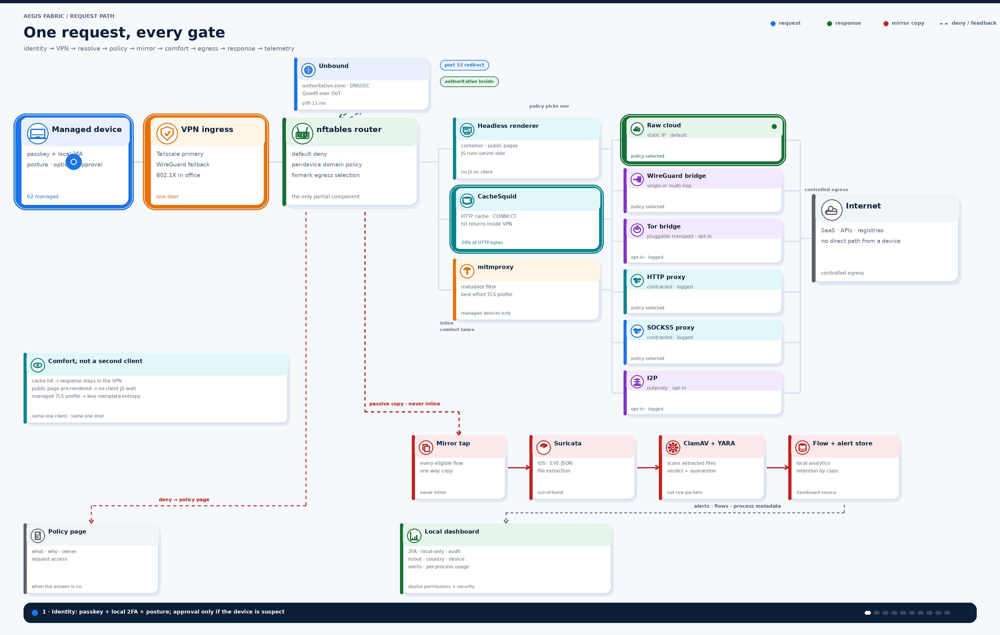
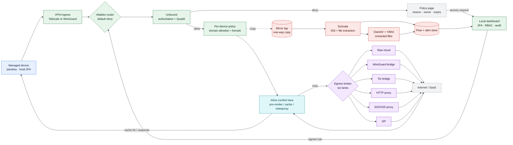
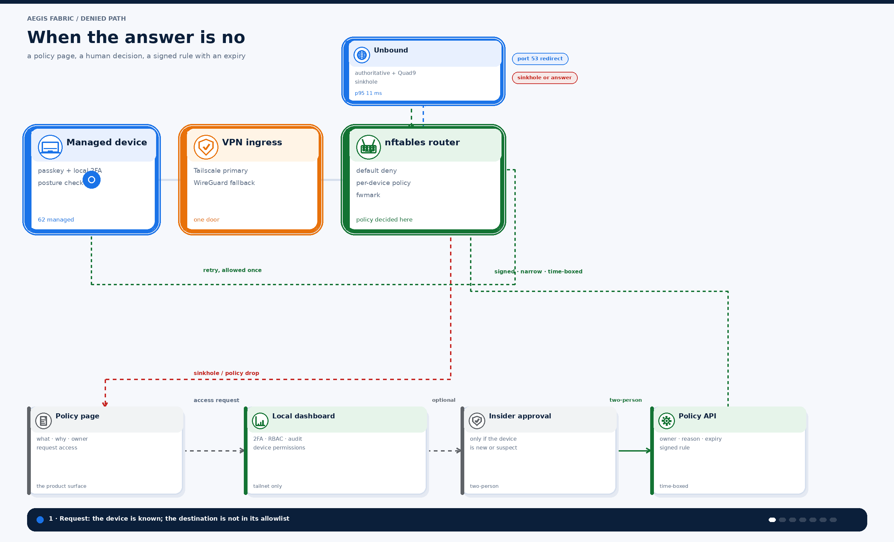
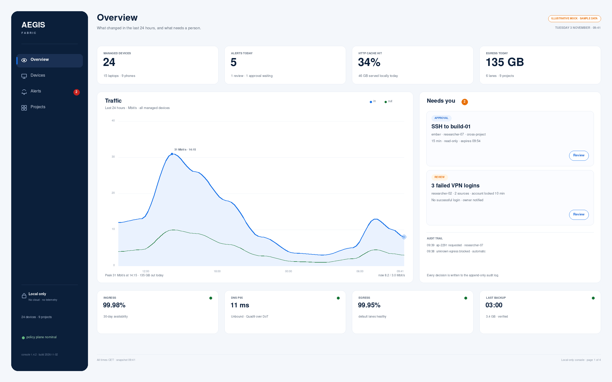
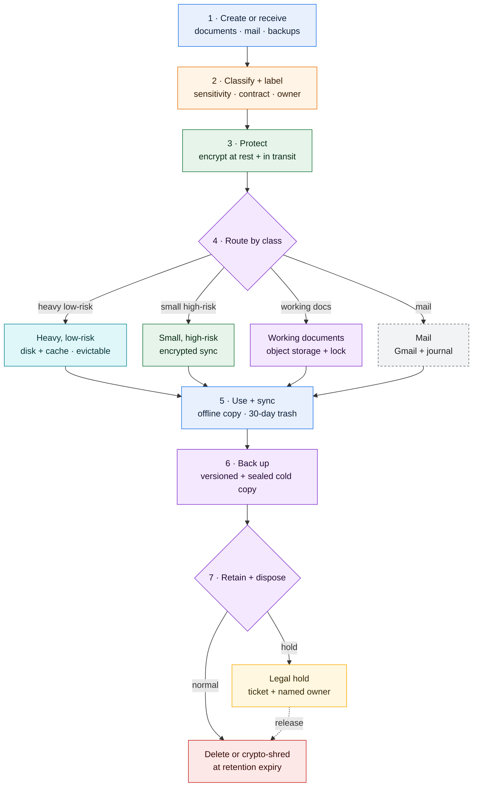
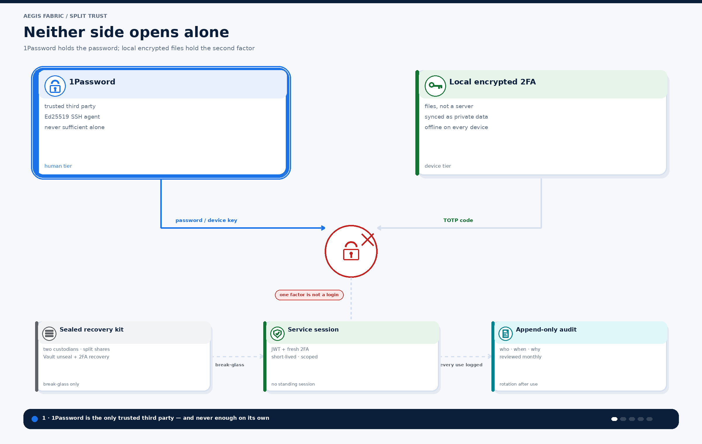
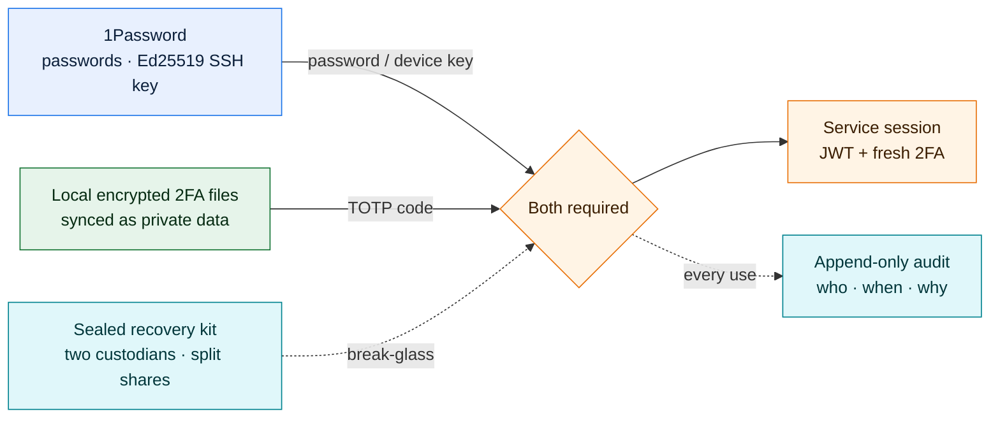
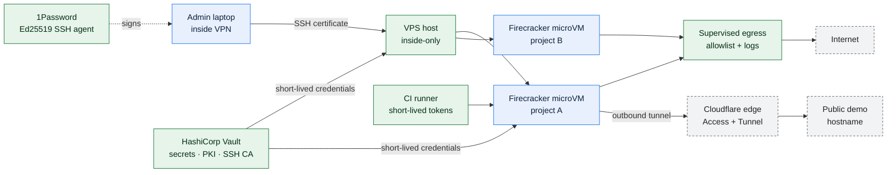
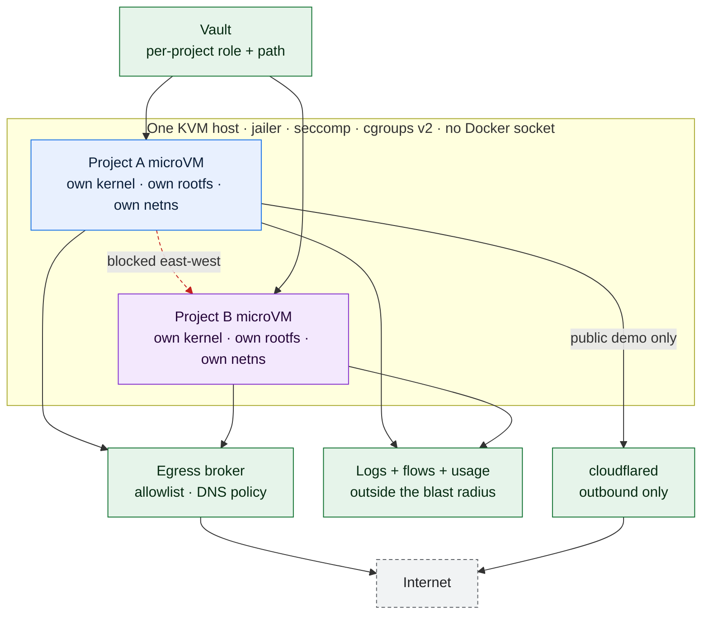

<div align="center">

# AEGIS Fabric

*One way in. One way out. No public admin plane.*




**12 weeks, part-time** · **12 people** · **24 managed devices** · **zero public admin ports**

</div>

`Linux` · `nftables` · `Tailscale` · `WireGuard` · `Unbound` · `Quad9` · `Suricata` · `ClamAV` · `YARA` · `CacheSquid` · `mitmproxy` · `Tor` · `I2P` · `Zabbix` · `HashiCorp Vault` · `Firecracker` · `cloudflared` · `1Password` · `Postfix` · `Loki` · `Prometheus`

> **A zero-trust build for a small studio of family and friends.** I built it as a favour, not a paid engagement.

A 12-person research studio had 24 managed devices, a flat `/24`, three public admin ports, no egress visibility, and one part-time IT generalist. Sensitive client work had to get safer without making anyone change how they worked.

---

## Contents

- [The brief](#the-brief)
- [Rules of engagement](#rules-of-engagement)
- [Threat model](#threat-model)
- [One request, every gate](#one-request-every-gate)
- [The six egress lanes](#the-six-egress-lanes)
- [When the answer is no](#when-the-answer-is-no)
- [Ingress and identity](#ingress-and-identity)
- [The router, state by state](#the-router-state-by-state)
- [Comfort lanes](#comfort-lanes)
- [Passive inspection](#passive-inspection)
- [The dashboard](#the-dashboard)
- [Data treatment: classify, protect, route, retain](#data-treatment-classify-protect-route-retain)
- [The split-trust bootstrap](#the-split-trust-bootstrap)
- [The dev island](#the-dev-island)
- [Project isolation: one microVM, one blast radius](#project-isolation-one-microvm-one-blast-radius)
- [Mail without trusting Google as the only archive](#mail-without-trusting-google-as-the-only-archive)
- [Hard parts and non-goals](#hard-parts-and-non-goals)
- [Decision log](#decision-log)
- [Policy as code](#policy-as-code)
- [Operations and SLOs](#operations-and-slos)
- [Delivery, gaps, and next](#delivery-gaps-and-next)
- [Pilot results](#pilot-results)
- [Appendix](#appendix)

---

## The brief

### The company

| Dimension | Detail |
|---|---|
| People | 12: a mix of researchers, developers, and operations — family and friends |
| Devices | 24 managed endpoints for 12 people: 15 laptops (12 staff, 3 shared test bench and spares) and 9 phones; one studio plus home offices |
| IT | One part-time generalist. Me as architect and engineer, as a favour. No SOC, no on-call, no physical security team |
| Cloud | Google Workspace, GitHub, Slack, a few public demo apps, several cloud VMs |
| Data | Client-confidential research, some under contractual security clauses; nFADP and GDPR obligations |
| Workstyle | Travel, client sites, home offices, and people who need offline access to sensitive files |

### The starting point

- A flat `/24`, a consumer-grade router, an end-of-life OpenVPN appliance, and no VLANs.
- 17 of 24 devices in MDM; full-disk encryption was inconsistent.
- Three public admin ports: a dev VPS running SSH, a NAS web UI, and the old VPN.
- A shared local administrator password in a spreadsheet.
- DNS went to the ISP; egress was unlogged. Nobody could answer "what left the network last Tuesday?"
- A NAS with RAID, no tested restore, and no offsite copy.
- Gmail only, no local archive; client data lived in Drive, on laptops, and on a dev VPS with open SSH.
- Long-lived developer SSH keys and cloud VMs with public addresses.
- Client security questionnaires answered with "we use Google" and hope.

```text
Internet
   │
   ├── consumer router ── flat 10.0.0.0/24 ── 24 devices
   │                              └── NAS (RAID, no restore)
   │
   └── port forward ── dev VPS :22 (public SSH)
```

### The ask, in the company's words

> "Threats come from outside. I want to control what enters and what leaves."
>
> "Protect me in any scenario, not only the scenarios we thought of today."
>
> "If it adds a click, people will route around it."
>
> "I don't want to trust Google with everything. But I can't stop using Gmail."
>
> "No physical keys. I will lose it, and then I'll be locked out."
>
> "My private files need to be on every device, even offline."
>
> "1Password is the only third party I really trust. But do not let it be enough on its own."
>
> "I have one IT person. It has to run itself."

### What I heard underneath the ask

1. **"Control input and output"** meant one chokepoint the company could reason about, with explicit states — not necessarily one physical box. A single box is a single point of failure.
2. **"Protect me in any scenario"** meant outside-in first, then compartmentalisation. An outside threat can still arrive on a laptop, so the inside cannot be a flat trusted LAN.
3. **"No friction"** meant identity must disappear after enrollment: no second VPN client, no daily captcha, no ticket to open a browser.
4. **"Don't trust Google"** meant keep Gmail's public trust and deliverability, but own the archive, retention, and eDiscovery copy.
5. **"No physical keys"** meant recovery and availability matter more than a token. Use passkeys, split trust, and a sealed break-glass kit.
6. **"Offline private data"** meant confidentiality and availability conflict. Classify the data, encrypt it, sync it, and accept a bounded loss window for unsynced edits.

### The premise

The company's premise was **outside-in**: threats come from outside, so control ingress and egress. I kept that as the primary model. I did not reframe the project as "assume breach" and I did not argue them out of their own threat model.

I added one sentence: **the outside gets in through a device.** Phishing, a lost laptop, a stolen SaaS session, a malicious dependency, and a developer's exposed SSH port all arrive from outside and then operate inside. So the design has two jobs:

- **Keep the outside out:** one ingress policy, one egress policy, no public admin plane.
- **Make the inside small:** segment the network, remove standing privileges, and make every device disposable.

That is the difference between a firewall project and a security architecture.

---

## Rules of engagement

These were the rules I wrote before choosing a single tool. Every component later had to justify itself against them.

| Rule | What it means | What it forced |
|---|---|---|
| **R1. Control both directions** | Ingress and egress are one policy problem, not two products. | VPN ingress, nftables router, egress broker, flow telemetry |
| **R2. Identity before address** | Every packet is attributable to a device and a user. An IP address is not an identity. | Tailscale device identity, 802.1X, per-device nftables sets |
| **R3. Default deny, explicit allow** | No implicit east-west traffic and no implicit egress. | Deny rules first; allowlists by destination category and device group |
| **R4. Enforce early, verify late** | DNS is the cheapest control; egress is the last chance. | Unbound, nftables, CacheSquid, and the egress broker — not one box doing everything |
| **R5. Inspect proportionately** | Mirror what is risky, not everything. Never put the inspection plane inline. | Passive tap, Suricata, file extraction, flow metadata |
| **R6. Admin is never public** | The control plane is not a website. | Local-only dashboard; overlay access; no Cloudflare route to admin |
| **R7. Classification drives storage** | Sensitivity, not convenience, decides where data lives. | Five storage classes with different sync, backup, and retention rules |
| **R8. Every control has a failure mode** | Fail closed where it matters; degrade gracefully elsewhere. | DNS fallback, egress failover, break-glass kit, restore drills |
| **R9. Buy commodity, build glue** | Do not rebuild Tailscale, Vault, or Cloudflare. | Tailscale and 1Password, plus custom router, policy, and dashboard |
| **R10. Handover is delivery** | The company must run it without me. | Runbooks, policy tests, restore drills, documentation |

### Non-goals

Explicitly out of scope: nation-state adversaries, physical coercion, a malicious root user on a managed device, perfect anonymity, full DLP on personal devices, and zero-day prevention. These are exclusions, not oversights.

The Tor and I2P lanes are **not anonymity claims**. They are opt-in, logged, rate-limited research lanes for public or non-confidential work. They are never used for client-confidential traffic.

---

## Threat model

| Threat | Realistic path | Primary control | Secondary control | Residual risk |
|---|---|---|---|---|
| Credential phishing | Fake Google login, session token theft | Passkeys (phishing-resistant), local 2FA, device approval | Conditional access, insider approval for a suspect device | Token theft on a compromised endpoint |
| Malicious download | Email link, SaaS attachment, package | Passive file extraction + ClamAV/YARA; Suricata alerts | Quarantine, endpoint detection | Encrypted archive or zero-day |
| Lost or stolen laptop | Physical access | Full-disk encryption, short lock, key-destruction wipe after N attempts, remote wipe | Encrypted sync and backup | Unsynced offline edits are lost — accepted |
| Data exfiltration | Personal SaaS upload, DNS tunnel | Egress allowlist, per-device lanes, DLP on managed inspection group | Volume alerts, contract terms | Encrypted exfiltration over an allowed SaaS |
| Lateral movement | Flat LAN, stolen session | VLANs, identity-aware access, no shared admin | Short-lived SSH certificates, mTLS | Compromised endpoint with a valid identity |
| Exposed dev service | Public SSH or HTTP | No public ingress; Cloudflare Tunnel for HTTP; Tailscale + SSH CA | External scan, config checks | Misconfigured tunnel |
| Supply chain | npm, pip, container image | Pinned dependencies, SBOM, signed artifacts, isolated runners, egress allowlist | Trivy, Syft, provenance | Upstream compromise |
| DDoS on public demo | Public app | Cloudflare, rate limits, queueing | Egress failover | Latency and detection coverage |
| Rogue device | Unmanaged laptop | 802.1X, device posture, guest VLAN | NAC quarantine | Credential sharing |
| Insider mistake | Wrong share or permission | Least privilege, audit, versioning, object lock | Two-person control for secrets | Authorized misuse |
| Mail archive loss | Google retention gap | Local journal, backup, restore drill | Retention policy | Mail in transit at Google |

### Trust boundaries

There are five boundaries, and each one has an explicit check:

1. **Device → access edge:** device identity, user passkey, local 2FA, posture, optional insider approval.
2. **Access edge → policy core:** Tailscale ACL or WireGuard key, then per-device nftables policy.
3. **Policy core → inspection plane:** one-way mirror copy; the inspection plane cannot block traffic.
4. **Policy core → egress:** destination category, device group, lane health, and explicit opt-in for anonymity lanes.
5. **Platform → data:** Vault-issued short-lived credentials; no standing database or SSH passwords.

The admin plane sits outside all five: reachable only from the tailnet, never from the public internet.

---

## One request, every gate

The animation at the top is the allowed path: identity → DNS → policy → passive mirror → inline comfort → egress → response → telemetry. It is not decoration. It is the build order: every gate below exists because a request would otherwise cross it unobserved.



### Step by step

1. **Identity.** The laptop joins the tailnet. Device approval, posture check, user passkey, and a local 2FA code happen before any packet reaches a resource. A new or suspect device can also require approval from an insider.
2. **Ingress.** Tailscale is the primary path; WireGuard is the bootstrap and break-glass fallback. Both terminate at the same policy router. There is no split tunnel and no second door.
3. **DNS.** The router redirects port 53 to Unbound. Unbound is authoritative for the internal zone and recursive for everything else. A per-group policy applies RPZ blocklists and returns a sinkhole for denied names.
4. **Resolution.** Allowed names resolve recursively through Quad9 over DNS-over-TLS with DNSSEC validation.
5. **Policy.** The router combines device identity, destination category, and time into a decision. The domain allowlist is not written directly into nftables; Unbound and a small controller resolve allowed names into nftables sets, and the proxy enforces host/SNI for the application layer.
6. **Mark.** The router marks the flow with `fwmark`. `ip rule` sends the marked flow to the routing table for the selected egress lane.
7. **Mirror.** A one-way copy of the eligible flow goes to the mirror tap. Suricata sees packets and flow metadata; file extraction hands objects to ClamAV and YARA. The real request does not wait for the inspection plane.
8. **Comfort.** The real request can use one of three inline lanes: a containerized headless renderer for public pages, CacheSquid for cacheable HTTP, or mitmproxy for managed inspection-group devices. A cache hit returns inside the VPN and never reaches egress.
9. **Egress.** The policy router selects one of six lanes from device group, destination, lane health, and explicit opt-in. The request leaves from a static IP, a WireGuard bridge, a Tor bridge, an HTTP proxy, a SOCKS5 proxy, or an I2P outproxy.
10. **Response.** The response returns through the same lane. CacheSquid caches it if it is cacheable.
11. **Telemetry.** DNS, proxy, flow, and alert records land in the local stores. Zabbix watches SLOs and capacity.
12. **Explain.** A blocked request returns a policy page with a reason, an owner, and an expiry. The dashboard is the only place to approve an exception.

### Pushed to the edges

The pilot moved 17/24 devices to **24/24**, public admin ports from **3 to 0**, phishing credential capture from **31% to 0%**, and alerts from **23/day to 5**. DNS p95 fell from **28 ms to 11 ms**; the added median latency is **+7 ms** on the raw cloud lane and **+12–18 ms** on the WireGuard bridge; **34%** of HTTP bytes are served from cache. Tor and I2P are outside the latency SLO by design. The full table is in [Pilot results](#pilot-results).

**Zero public admin ports. 100% device coverage. A restore that has actually been performed.** Those are the three lines I would put in front of a client's security questionnaire.

### The one-line pipeline

```text
passkey + local 2FA → Tailscale → nftables → Unbound → mirror (copy)
                                              │
                                              ├── Suricata → file extraction → ClamAV/YARA
                                              │
                                              └── inline comfort: pre-render / CacheSquid / mitmproxy
                                                        │
                                                        └── fwmark → raw / WG / Tor / HTTP / SOCKS5 / I2P
                                                                          │
                                                                     Internet
                                                                          │
                                                              response + metadata
                                                                          │
                                                                local dashboard
```

---

## The six egress lanes

Default egress is deny. A lane is chosen from **destination category + device group + time + health**, not from a user prompt. If all permitted lanes fail, the router fails closed and pages.

| Lane | Use case | Identity at the far end | Logging | Constraint |
|---|---|---|---|---|
| **Raw cloud** | Sanctioned SaaS, package registries, vendor APIs | Static IP per egress VPS; per-device NAT | NetFlow + proxy logs | Default lane; rate limits; health-checked failover |
| **WireGuard bridge** | Sensitive research traffic; jurisdiction diversity | Two providers, two regions; no inbound | Flow metadata only | Adds ~12–18 ms; not an anonymity claim |
| **Tor bridge** | Public-source research, censorship testing, OSINT | Tor exit node; bridge with pluggable transport | Opt-in event + volume metadata | Opt-in, rate-limited, never for client-confidential traffic; exit nodes are public |
| **HTTP proxy** | Vendor/API requirements; regional testing | Contracted account; destination allowlist | Request metadata | No residential pools; no open proxies |
| **SOCKS5 proxy** | Applications that need a SOCKS endpoint; regional testing | Contracted account; destination allowlist | Connection metadata | No open proxies; no credential forwarding |
| **I2P** | Niche public research; isolated eepsite testing | I2P outproxy | Opt-in event + volume metadata | Limited outproxy ecosystem; not a general drop-in; never for confidential traffic |

The Tor and I2P lanes exist because the company asked for them and because they are legitimate research tools when scoped. They are not sold as anonymity against a global adversary, and they are not part of the confidentiality boundary. The design keeps them **opt-in, logged, rate-limited, and separate from the default lane**.

---

## When the answer is no



*Animation: the denied path. A deny is a product surface, not a dead end. Sanitized and illustrative.*

A blocked request is where most security projects lose the user. The design treats the policy page as part of the product:

- The block page says **what** was blocked, **which policy** matched, **who owns it**, and **when the exception expires**.
- The user requests access from the page. The request lands in the dashboard, not in a ticket queue.
- Approval needs a passkey and a fresh local 2FA code. If the device is new or suspect, an insider must also approve.
- The policy API renders a narrow, signed rule. The router gets an allow for that destination and device group only.
- The rule expires automatically. A permanent exception requires a new decision, not a forgotten ticket.

This is slower than a blanket allow. That is the point. The alternative is a policy nobody can explain and an exception list nobody can prune.

---

## Ingress and identity

| Path | Who | Authentication | Exposure | Notes |
|---|---|---|---|---|
| **Tailscale tailnet** | Managed laptops and phones | Passkey + local 2FA + device approval; ACL tags | No public port | Primary path; exit node; subnet routers; Tailscale SSH |
| **WireGuard fallback** | Bootstrap, break-glass, non-Tailscale hosts | Ed25519 key + local 2FA | One UDP port on an edge VPS | No shell; IP allowlist; key rotation |
| **Cloudflare Tunnel + Access** | Public demo apps only | Cloudflare Access (SSO or one-time PIN) | HTTPS via Cloudflare | `cloudflared` is outbound-only; no admin route |
| **Office 802.1X** | Wired and wireless | Device certificate + user | Local only | VLAN assignment; guest isolated |
| **No port forwarding** | — | — | **0 inbound admin ports** | Verified by external scan |

The important detail is not "VPN." It is that **every user ingress path terminates at the same policy router**, so a user cannot get a different policy by choosing a different door.

### The ingress challenge

A login is not a password prompt. It is a sequence:

1. **Passkey** — phishing-resistant, tied to the device and the origin.
2. **Local 2FA** — a TOTP code from encrypted files that live on every managed device, not from a self-hosted TOTP server.
3. **Posture** — disk encryption, OS version, EDR present, screen lock.
4. **Optional insider approval** — only when the device is new, re-imaged, or flagged as suspect.

A new device can enroll, but it cannot silently become trusted. A stolen session cannot add a new device without the second factor and, if the risk score is high, a second human.

### Internal services

Every internal service sits behind an identity-aware reverse proxy that validates a short-lived JWT and requires a fresh 2FA step for sensitive actions. No service has its own public login page. The dashboard, Vault, and the policy API are on the tailnet only.

---

## The router, state by state

The router is the only place where policy is decided. DNS, the proxies, and the egress broker are enforcement points. The router has five explicit states:

| State | What happens | Why |
|---|---|---|
| **1. Resolve** | Unbound answers from the authoritative internal zone or recurses through Quad9 over DoT | Names before packets; DNSSEC and sinkholes |
| **2. Decide** | Device group + destination category + time + lane health produce an allow/deny | One explainable decision |
| **3. Mark** | `nftables` sets `fwmark`; `ip rule` selects the routing table for the egress lane | Policy routing without application changes |
| **4. Copy** | An eligible flow is mirrored one-way to Suricata and file extraction | Analytics and evidence without latency |
| **5. Forward** | The real request uses an inline comfort lane or goes straight to the selected egress lane | Comfort and control in the same path |

### The domain-policy nuance

`nftables` cannot match a domain name directly. A rule that says `daddr example.com` is not a thing. The build handles this in three layers:

1. **Unbound/RPZ** blocks or sinkholes names at resolution time.
2. **A small controller** resolves allowed names into nftables sets and refreshes them, so L3/L4 rules can match IPs with an expiry.
3. **The proxy** enforces host and SNI for HTTP(S), including CONNECT, so a flow cannot claim one name and use another.

That is why the router is described as a **policy router**, not a domain firewall. The domain intent lives above it; the enforcement is split between DNS, sets, and the proxy.

### Policy router skeleton

This is a simplified excerpt, not a runnable config. Sets, IPv6, logging rates, and service definitions are omitted.

```nft
table inet aegis {
  set mgmt    { type ipv4_addr; flags interval; }
  set trusted { type ipv4_addr; flags interval; }
  set internal { type ipv4_addr; flags interval; }

  chain dns_hijack {
    type nat hook prerouting priority dstnat; policy accept;
    iifname { "tailscale0", "wg0", "eth1" } udp dport 53 redirect to :53
    iifname { "tailscale0", "wg0", "eth1" } tcp dport 53 redirect to :53
  }

  chain mark_egress {
    type filter hook prerouting priority mangle; policy accept;
    ip saddr @trusted ip daddr @internal return
    ip saddr @trusted tcp dport { 80, 443 } meta mark set 0x10
  }

  chain forward {
    type filter hook forward priority filter; policy drop;
    ct state established,related accept
    ip saddr @mgmt accept
    ip saddr @trusted jump allow_egress
    counter log prefix "aegis-drop " drop
  }

  chain allow_egress {
    ip daddr @internal accept
    meta mark 0x10 accept
    udp dport 123 accept
    counter log prefix "aegis-egress-deny " drop
  }
}
```

```bash
# One routing table per egress lane; nftables sets the mark.
ip rule add fwmark 0x10 table 100   # raw cloud
ip rule add fwmark 0x20 table 200   # WireGuard bridge
ip rule add fwmark 0x30 table 300   # Tor bridge
ip rule add fwmark 0x40 table 400   # HTTP proxy
ip rule add fwmark 0x50 table 500   # SOCKS5 proxy
ip rule add fwmark 0x60 table 600   # I2P

ip route add default via 10.10.0.1 table 100
ip route add default dev wg-egress table 200
```

---

## Comfort lanes

The brief said "increase comfort without new friction." That is not a soft requirement; it is why the inline lanes exist. The user does not install a second client or learn a new workflow.

| Lane | What it does | What the user sees | Constraint |
|---|---|---|---|
| **Headless renderer** | A containerized browser fetches and renders public pages inside the VPN, then sends a readable result | A page that arrives ready, without client-side JS waiting | Public/read-only pages only; no session, no credentials; SSRF and DNS-rebinding checks; egress allowlist |
| **CacheSquid** | Caches cacheable HTTP, handles CONNECT, and returns a hit inside the VPN | Faster repeat visits; less WAN traffic | Cache poisoning risk: pinned upstreams, validation, explicit CONNECT policy |
| **mitmproxy** | Filters metadata, normalizes headers, and presents a consistent managed TLS profile | Fewer tracking parameters and a less unique fingerprint | Managed devices only; changes the TLS ClientHello; fingerprint normalization is best-effort, not perfect spoofing |

The renderer is not a general-purpose web proxy. It runs in a container, has no user session, and is limited to public pages. The cache is not a standalone Squid appliance; CacheSquid is the named cache tier. mitmproxy is not applied to personal devices, banking, health, personal mail, or pinned apps.

### What caching actually buys

The cache hit rate is 34% of HTTP bytes. That is nice, but the point is not the number. The point is that a hit **never reaches the WAN**, so the fastest request is the one the network does not make. The second point is that new objects can be extracted from the mirrored flow and scanned, so a verdict can quarantine them even when the first download already happened.

### What mitmproxy does not do

mitmproxy terminates and re-originates TLS, so the ClientHello the destination sees is mitmproxy's, not the browser's. A managed TLS profile can make that consistent across the inspection group, but it cannot reproduce every browser fingerprint perfectly. The honest claim is **"consistent managed profile and reduced metadata entropy"**, not "perfect browser spoofing."

---

## Passive inspection

The mirror is not "copy everything." It is a policy decision with four inputs:

| Trigger | What is mirrored | Why |
|---|---|---|
| **Device group** | Inspection group, elevated-risk devices, newly enrolled devices | Higher risk or higher uncertainty |
| **Flow novelty** | First-seen destination, new ASN, new SNI, unusual port | Unknown is more interesting than known |
| **Risk signal** | DLP hit, IDS alert, DNS anomaly, volume spike | Preserve evidence around an event |
| **Sampling** | 1:20 baseline for eligible flows | Statistically useful without full storage |

Flows that are not mirrored still produce NetFlow/IPFIX metadata. The inspection plane cannot block traffic; it only observes and alerts. Blocking happens at the router, DNS, or proxy.

### Files, not packets

ClamAV scans files, not raw packets. The mirror pipeline therefore has a file-extraction step: Suricata extracts objects from eligible flows, and ClamAV/YARA scans those objects. A packet-only mirror with a ClamAV logo on it would be dishonest.

```text
router ──copy──► mirror tap ──► Suricata ──► file extraction ──► ClamAV + YARA
                                  │                                      │
                                  └──────────► flow + alert store ◄──────┘
                                                        │
                                                   dashboard
```

### Telemetry

- **Flow metadata:** `softflowd` (NetFlow v9) or an IPFIX exporter to the local flow/alert store; 90-day retention.
- **DNS metadata:** Unbound query logs; 90-day retention.
- **Proxy metadata:** CacheSquid and mitmproxy logs; 30-day retention.
- **IDS metadata:** Suricata `eve.json` for alerts, flows, DNS, TLS, and file info; 30 days, longer for incidents.
- **Endpoint:** osquery/eBPF agent for posture and per-process usage; 30 days.
- **Metrics:** Zabbix agents plus Prometheus exporters for services that expose them.
- **Logs:** Vector → Loki for service logs.
- **Availability:** Zabbix agents, SNMP, synthetic probes, and web scenarios.
- **Alerting:** Zabbix escalations; the dashboard is the single pane for triage.

### What is monitored — and what is not

| Data | Source | Purpose | Retention | Access |
|---|---|---|---|---|
| Flow metadata (5-tuple, bytes, ASN, geo) | nftables, softflowd | Capacity, anomaly detection, incident scope | 90 days | Security lead + IT |
| DNS metadata | Unbound | Policy, tunneling detection, incident scope | 90 days | Security lead + IT |
| HTTP/proxy metadata | CacheSquid, mitmproxy | DLP, policy, cache performance | 30 days | Security lead |
| Packet payload from mirrored alerts | Suricata ring | Incident evidence | 30 days, encrypted | Two-person access |
| Endpoint process telemetry | osquery/eBPF | Per-process usage, posture | 30 days | IT + device owner |
| Authentication logs | Tailscale, Vault, 1Password | Access review, incident response | 1 year | Security lead |
| Mail journal | Postfix | Retention, eDiscovery | Per contract | Legal + IT |
| Personal devices | Guest VLAN | Connectivity only | Aggregate volume only | Nobody |

**Only company-owned devices are inspected.** Personal devices get the guest VLAN, no endpoint agent, no TLS inspection, and no per-user traffic view. This is both a legal position and a cultural one: the company secures its own equipment, not its employees' lives.

### Guardrails

- **TLS inspection is scoped.** Only the managed inspection group. Notice is in the acceptable-use policy. Banking, health, personal mail, and certificate-pinned apps are excluded. The inspection CA is deployed by MDM, and content is not retained unless there is a DLP incident.
- **No full packet capture by default.** Mirroring is selective, time-boxed, and tied to a trigger.
- **Retention is capped.** Automated deletion; legal hold requires a ticket and an owner.
- **Payload access is two-person.** The audit log is append-only and reviewed monthly.
- **Data residency is Switzerland/EU** where the vendor allows it. Subprocessors are listed and covered by DPAs.
- **Employee notice and works council review** are part of the rollout, not an afterthought.
- **Incident response:** internal notification within 24 hours; regulatory notification within 72 hours where required.

---

## The dashboard

The dashboard is the control plane and the product surface. It is **local-only**, reachable from the tailnet, with 2FA, RBAC, and an append-only audit trail. There is no public DNS record and no Cloudflare route to it. The dashboard is allowed to be the place where a non-technical owner can see the whole system without learning nftables.



*Illustrative mock, not a screenshot. Device names, project names, people, and addresses are placeholders; the aggregates follow the pilot figures in this README. No real data, names, credentials, or addresses are shown.*

The animation exists because most readers will never see the real console, and a table of capabilities is a poor substitute for watching a blocked flow, an approval, and a kill-and-rebuild drill in sequence. It is deliberately labelled as a mock. The real dashboard is not a public demo.

| Capability | What it shows | Who can use it |
|---|---|---|
| **Device permissions** | Which device belongs to whom, which group, which egress lanes, which exceptions | IT + security lead |
| **Traffic in/out** | Bytes and flows by device, direction, country, ASN, and destination category | IT + security lead |
| **Alerts** | Suricata, ClamAV/YARA, DNS anomaly, lane health, policy changes | Security lead; IT read-only |
| **Device usage** | Per-device and per-process usage from the endpoint agent; top talkers; time-of-day | IT + device owner |
| **Security monitoring** | Posture drift, failed auth, new devices, blocked flows, exception expiry | Security lead |
| **Projects** | Nine isolated projects, per-project CPU / memory / egress, kill and rebuild state, drill history | IT + security lead |
| **Approvals** | Access requests with owner, reason, expiry, and optional insider approval | Device owner + approver |
| **Audit** | Append-only record of policy changes, approvals, break-glass, kill and rebuild events | Security lead; auditor read-only |

Attribution is split honestly: the router sees destinations from DNS and SNI, and it reports device-level flows. Correlating PID to flow at the router is still a planned eBPF pilot. The dashboard does not pretend the router already knows the process.

---

## Data treatment: classify, protect, route, retain

"Where does the data live?" is the wrong first question. The useful question is "what happens to it, in order?" A file that is never classified cannot be routed; a file that is never labelled cannot be deleted on purpose. The lifecycle below is the one the company can explain to a customer.



Read it as three promises: every item has a class and an owner; the class decides where it lives and how long it lives; deletion is an event with a timer, not a best effort.

| Stage | What happens | Control | Where to look |
|---|---|---|---|
| **1 · Intake** | A document is created, received, or restored into a project folder, mailbox, or backup set | Owner is assigned at intake; unknown data does not sync | Project folder, mail journal, backup catalogue |
| **2 · Classify** | The item gets one of five classes plus contract or regulatory tags | No class means no sync; classification is reviewed like policy | Object metadata, policy repo |
| **3 · Protect** | TLS in transit, full-disk encryption at rest, encrypted sync, encrypted object storage, sealed cold copy | Keys are separated from the data they protect | Device posture, storage config, key custody |
| **4 · Route** | The class picks the store: cache, every device, object storage, or Gmail plus journal | Routing is code, not a person moving files | Sync rules, bucket policy, mail journal |
| **5 · Use** | People work offline, sync changes, restore from version history or the 30-day trash | Managed devices only; personal devices stay on the guest VLAN | Endpoint agent, sync client |
| **6 · Back up** | Versioned object storage plus a sealed offline copy | Object lock; restore drills on a schedule | Backup catalogue, restore report |
| **7 · Retain / dispose** | A retention timer deletes the item, unless a legal hold names an owner | Legal hold is a ticket, not an email; release returns to the timer | Retention report, hold register |

The five classes are deliberately small enough to remember:

| Class | Example | Where it lives | Sync | Backup | Trade-off |
|---|---|---|---|---|---|
| **Heavy, low-risk** | Course video, public datasets, rendered media | Disk and cache-heavy store | Not to every device | Object storage | Eviction is acceptable; re-download is cheap |
| **Small, high-risk** | Client notes, local 2FA seed files, contracts | Encrypted files on every managed device | Yes, private-data sync | Versioned object storage + cold copy | Device loss is a hardware event, not a data event |
| **Working documents** | Active project files | Object storage + local working copy | Per project | Versioned + object lock | Conflict resolution needs discipline |
| **Mail** | Gmail messages | Gmail public MX + private journal host | Journal only | Object storage + cold copy | Mail transits Google |
| **Backups** | Restore points | Versioned object storage + offline copy | No | Object lock + sealed cold copy | Restore drills are mandatory |

High-risk data is synced to every managed device because every managed device is forced onto the VPN and follows strict hardware rules:

- full-disk encryption required before enrollment;
- short screen lock;
- key-destruction wipe after a low number of failed attempts;
- data is re-downloadable, so a stolen device is a hardware loss, not a data loss;
- sync keeps version history and a 30-day trash;
- object storage keeps an immutable copy.

### Key custody

The design does not put every secret in one vault and call it a day. Custody is split so that one compromised account, one lost laptop, or one angry administrator is not enough.

| Secret or key | Custodian | Recovery | Rotation |
|---|---|---|---|
| **Human passwords and passkeys** | 1Password | Sealed kit with split shares held by two custodians | On offboarding, suspected compromise, or kit use |
| **Second factor** | Local encrypted 2FA files, synced as private data | Same sealed kit | On device loss or compromise |
| **SSH access** | 1Password SSH agent plus Vault SSH CA | Vault role with a time-boxed approval | 15-minute certificates; no standing key on disk |
| **Service credentials** | Vault role and path per project | Break-glass role, audited and time-boxed | On kill/rebuild and on a schedule |
| **Device data** | OS full-disk encryption | Recovery key in the sealed kit, not in a spreadsheet | On device retirement or compromise |
| **Cold copy** | Storage-layer encryption plus a separate key | Split shares in the sealed kit | After a restore drill or kit use |

No single person, including the architect, can open production alone. The kit is checked quarterly and rotated after every use; every break-glass action lands in the audit trail with a reason and an owner.

### What is visible, and what is not protected

Encryption changes who can read data. It does not make data invisible.

| Layer | What is visible | What is not protected |
|---|---|---|
| **Network metadata** | 5-tuple, DNS name, TLS SNI, byte counts, timing, destination country and ASN | Correlation of who talked to whom and when; payload outside the inspected group |
| **Managed endpoint** | Process, file, and network metadata from osquery/eBPF; screen-lock and disk-encryption posture | An unlocked session, malware running with the user's rights, screenshots, a document copied into an allowed app |
| **Sync and storage** | Object size, timestamps, version count, bucket and project name | Provider-side metadata and legal compulsion; content is encrypted |
| **Mail** | Gmail sees the message in transit and at rest; the journal sees a copy | Recipient copies, forwarding, and anything sent outside the journal path |
| **Backups** | Backup catalogue, schedule, restore history | Loss of the sealed key makes the cold copy unreadable; that is the intended failure mode |
| **Personal devices** | Aggregate guest-VLAN volume only | No inspection, no endpoint agent, no per-user view |

The honest limits are the endpoint, the allowed destination, and the person with legitimate access. This is data treatment, not DLP magic. It does not stop a user from copying an allowed document into an allowed SaaS, taking a screenshot, or clicking a link on a compromised laptop. It does make the default path classified, encrypted, routed, backed up, and deletable.

### Retention and deletion

| Data | Retention | Deletion | Legal hold |
|---|---|---|---|
| **Flow and DNS metadata** | 90 days | Automatic | Ticket plus named owner |
| **Proxy metadata** | 30 days | Automatic | Ticket plus named owner |
| **IDS metadata** | 30 days; longer for an incident | Automatic, except incident evidence | Incident owner |
| **Endpoint telemetry** | 30 days | Automatic | Ticket plus named owner |
| **Authentication logs** | 1 year | Automatic | Ticket plus named owner |
| **Mail journal** | Per contract | Contract end plus retention | Legal hold |
| **Project VM disks** | Ephemeral | Wiped on kill; rebuilt from a signed image | Not applicable |
| **Deleted files** | 30-day trash | Automatic after the timer | Hold suspends the timer |
| **Backups** | Per schedule; restore-tested quarterly | Expiry plus key destruction for the cold copy | Hold suspends expiry |

Crypto-shredding is the last step for encrypted cold copies: destroy the key, and the ciphertext becomes useless even if a copy survives. The hold register is reviewed quarterly; a hold that cannot name an owner and a matter is released.

What the company can say in plain language: **every project file is labelled, encrypted, and synced to managed devices; every copy is backed up; deleting it starts a 30-day timer; a legal hold stops the timer; a lost laptop is a hardware event, not a data event.**

The accepted loss is unsynced edits. If a device dies between syncs, the last local change is gone. That is a documented trade-off, not a surprise.

---

## The split-trust bootstrap



*Animation: neither side opens alone; the sealed kit is the only break-glass path. Sanitized and illustrative.*

This is the part I am most careful about. Trust is tiered, not absolute.



1Password is the only third party the company really trusts, because of its track record, not because of magic. But it is **never sufficient alone**. Every human login also needs a second factor from local encrypted files that are synced as private data to every managed device. Neither can open an account alone:

- 1Password cannot complete the login without the local 2FA code.
- The local 2FA files are useless without the 1Password entry.
- The local 2FA store is not a self-hosted TOTP server. It is a set of encrypted files, synced like other high-risk private data, with offline access on every managed device.

Day-to-day, both are required. In a disaster, a sealed recovery kit provides a time-boxed break-glass path with two custodians and an audit entry. The kit is rotated after use and checked quarterly. No single person, including the architect, can unlock production alone.

This is deliberately inconvenient. The alternative — one vault that opens everything — is a single point of compromise with a very friendly user interface.

---

## The dev island

The dev environment is not a public cloud account with a bastion and hope. The dev host is reachable only from inside the VPN. The SSH key is Ed25519 and held by 1Password's SSH agent. Secrets live in HashiCorp Vault. Each project runs in its own Firecracker microVM, with 2FA on each project and supervised internet access. Public projects are exposed through `cloudflared` Zero Trust, not a public port. The microVM boundary is important enough to have its own section: [Project isolation](#project-isolation-one-microvm-one-blast-radius).



- **VPS only reachable from inside.** No public SSH. No public admin port. The host firewall accepts the tailnet and the WireGuard fallback only.
- **Ed25519 key in 1Password.** The private key is not on disk in a plain file; the agent signs on demand.
- **Secrets in Vault.** Applications get short-lived credentials, not a `.env` with a production password.
- **One Firecracker microVM per project.** Nine projects, nine kernels, no shared container runtime. The next section covers the boundary, access, network, telemetry, and the kill-and-rebuild drill.
- **A separate 2FA gate per project.** A compromised project does not automatically become every project.
- **Supervised internet.** Project VMs use the same egress policy and logging; they do not get a raw NAT.
- **Public projects through `cloudflared` Zero Trust.** Outbound-only connector, no inbound port, Access policy in front.

---

## Project isolation: one microVM, one blast radius

Nine projects. Nine microVMs. One host. The unit of failure is the project, not the host, the container runtime, or a shared database.

Each project is a Firecracker microVM with its own guest kernel, root filesystem, network namespace, identity, Vault path, and telemetry stream. This is a stronger boundary than a container or a Kubernetes namespace on a shared runtime: a container escape is a bad day; a microVM escape should require a KVM or hardware bug, not a shared-kernel bug. The host is deliberately boring: Linux, KVM, the jailer, seccomp, cgroups v2, no Docker socket, no host mounts, and signed read-only base images.



The dotted red link is the path that must never work. Everything else in the diagram is a deliberate, logged path.

### The boundary

| Dimension | What each project gets | What is explicitly not shared | What a leak would mean |
|---|---|---|---|
| **Kernel** | Its own guest kernel, booted by the jailer | The host kernel, the container runtime, kernel namespaces | A KVM or hardware bug, not a shared-kernel exploit |
| **Runtime** | A read-only base image plus an ephemeral writable disk | Docker socket, host mounts, other projects' volumes | A compromised image is rebuilt, not repaired in place |
| **CPU / memory / disk** | cgroups v2 quotas and a per-project disk quota | Unbounded host resources | A noisy neighbour is throttled; it is not a confidentiality boundary |
| **Network** | Its own network namespace, default deny, no inbound | The host network, a shared bridge, east-west traffic | A policy mistake, not a shared-interface shortcut |
| **Identity** | Its own 2FA gate, owner, backup owner, SSH principal, Vault role | Passwords, SSH keys, Vault tokens between projects | A stolen credential is scoped to one project and expires |
| **Data** | An ephemeral disk and scoped object-store credentials | Shared volumes, shared database roles, another project's path | A mis-scoped role is a finding; the default is no path |
| **Telemetry** | Its own log, flow, and usage stream with a project label | The collector's credentials and storage | A log outage is visible; it does not grant access |

The boundary is not a vibe. It is a set of negative tests: A cannot reach B, the VM cannot reach the host, the metadata service is unreachable, and direct egress is denied. Those tests run on every deploy.

### Access and secrets

- **Per-project 2FA gate.** A project has an owner and a backup owner. There is no shared project password and no "just this once" shared session.
- **Short-lived SSH.** Vault's SSH CA issues a 15-minute certificate bound to the project principal. The private key stays in 1Password's agent; there is no standing key on disk.
- **Per-project Vault role and path.** An application gets short-lived credentials for its own path. A read against another project's path returns `403`, not a helpful error.
- **Time-boxed approvals.** A request is raised on the policy page with a reason, scope, and expiry. The owner approves with 2FA; the grant expires even if nobody remembers to revoke it.
- **Audited break-glass.** The sealed kit and the break-glass role need two custodians. Every use is logged with a reason, an owner, and a review date.
- **Rotation on rebuild.** Killing a project revokes its Vault role, SSH principal, and egress identity. The rebuilt VM gets fresh credentials, not the old ones with a new coat of paint.

### Network

- **Default deny.** No inbound, no east-west between projects, no raw NAT, no direct internet.
- **Egress only through the broker.** Each project has an allowlist by destination category; the broker applies DNS policy and logs the flow.
- **Metadata blocked.** `169.254.169.254` and host services are unreachable. There is no cloud instance role to steal.
- **Public only through `cloudflared`.** An outbound-only connector with an Access policy in front; no inbound port on the project.
- **Quotas and rate limits.** A project can be throttled without taking the host or its neighbours down.
- **No shared DNS resolver state.** Project DNS goes through the policy path; a compromised project cannot poison another's resolution.

### Telemetry

- **Per-project logs and flows.** Auth, build, file, and flow events carry the project label. The collector lives outside the VM, so killing the VM does not destroy the evidence.
- **Per-project usage.** CPU, memory, disk, and egress are charted per project, not just per host. A noisy project is visible before it becomes a neighbour problem.
- **Per-project egress.** The dashboard shows a project's share of total egress, not just its CPU and memory.
- **Alerts with an owner.** A project alert goes to the project owner and the security lead. The global alert ceiling stays at five actionable alerts per day; everything else is a dashboard or a weekly review.
- **Retention matches the data policy.** Flow and DNS metadata 90 days, proxy and endpoint telemetry 30 days, auth logs one year, incident evidence longer with two-person access.

### Failure containment: kill, rebuild, prove

The drill is deliberately boring, because a dramatic incident is the wrong time to invent a procedure.

1. **Freeze.** Revoke the project's Vault role and SSH principal, remove it from the egress allowlist, and quarantine any public route.
2. **Preserve.** Logs and flows are already outside the VM. A memory snapshot is taken only for an incident that needs it, with two-person access.
3. **Kill.** Stop the microVM through the jailer, unmount the ephemeral disk, and wipe it. The neighbour keeps serving.
4. **Rebuild.** Boot the same signed base image, get a new kernel and a fresh project identity, and re-issue credentials from Vault.
5. **Verify.** Run the isolation tests, smoke-test the project, and confirm the neighbour's latency and error rate did not move.
6. **Review.** Rotate secrets, update the test that should have caught the issue, and record the drill result.

The target is under five minutes from freeze to serving. The measured lab result is **94 seconds**, including a fresh kernel and new credentials. That number is in the dashboard mock and in the drill history, not in a slide.

### Isolation tests

| Test | Method | Expected result | Last drill |
|---|---|---|---|
| **Project → project** | TCP connect from A to a B service on the project network | Timeout; no route | Pass |
| **VM → host** | Connect to host SSH, API, and management ports | Refused; no host route | Pass |
| **Metadata service** | Request `169.254.169.254` from inside the VM | Timeout; no credentials | Pass |
| **Direct egress** | `curl` a public IP without the broker | Timeout; no raw NAT | Pass |
| **DNS bypass** | Query a known DoH/DoT endpoint | Blocked at egress | Pass |
| **Cross-project Vault** | Read B's path with A's role | `403`; audit entry | Pass |
| **Host mounts** | List mounts and block devices inside the VM | Rootfs and ephemeral disk only | Pass |
| **Kill and rebuild** | Kill A, rebuild from the signed image, time to serving | Under five minutes; measured 94 s | Pass |
| **Neighbour impact** | Serve B traffic throughout A's rebuild | No errors; latency within SLO | Pass |

*Representative lab run, 2026-10-28, sanitized. These are the assertions the drill enforces, not a certification.*

### What isolation does not cover

- **A KVM or hardware bug.** The boundary is strong, not absolute. A hypervisor escape is a different class of incident.
- **Root on the host.** Whoever owns the host owns every project. The host is patched, minimal, and reachable only from the tailnet, but it is still a single trust domain.
- **The supply chain.** A signed base image helps with integrity; it does not prove that every dependency is benign.
- **Side channels and resource exhaustion.** cgroups limit the damage; they do not make a shared CPU or cache invisible.
- **The public demo path.** `cloudflared` removes the inbound port, not the application vulnerability.
- **A user with legitimate access.** Data copied into an allowed destination is a DLP problem, not an isolation problem.
- **Human error.** A wrong allowlist or a mis-scoped role is still possible. Tests and review reduce it; they do not remove it.
- **Physical access.** A stolen unlocked laptop is outside this boundary.

The isolation boundary is implemented and tested at the level described here. The router remains the only core component I would not call finished.

---

## Mail without trusting Google as the only archive

Gmail stays the public MX. That keeps deliverability, reputation, spam filtering, and the familiar client. The company does not want to run a public mail server for 12 people.

What changes is the archive:

1. Gmail receives and sends as before.
2. Messages are forwarded or journaled to a private host.
3. The private host indexes and stores them in object storage with retention and legal hold.
4. The local archive is backed up and restore-tested like any other data class.

The result is **Gmail's public trust without Google as the only archive**. The trade-off is that mail still transits Google; the design does not pretend otherwise. The goal is ownership of retention and eDiscovery, not a fantasy of mail that never touches a third party.

---

## Hard parts and non-goals

- **DNS is the cheapest control, and the least honest one.** Blocking a name before a connection exists is faster and more private than blocking a flow after the fact. It is also a cat-and-mouse game with DoH, pinned resolvers, and tunnels. The honest claim is "the default path is filtered", not "DNS cannot be bypassed."
- **Per-device policy is a data problem.** Twenty-four devices do not justify a proprietary console, but they do justify a schema, a review flow, and a test suite. Device intent lives in Git and renders into nftables sets; a bad rule is a diff, not a mystery.
- **Selective mirroring is a policy decision.** At 24 devices and ~2 Mbps each, the network carries roughly 0.5 TB/day. A week of full PCAP is ~3.5 TB plus a privacy liability; a 1:20 baseline plus triggers gives the investigative value without the bulk.
- **Offline private data is a conflict, not a feature.** High-risk data lives on every managed device and stays available offline, so the device is both the backup and the risk. Full-disk encryption, remote wipe, version history, and a 30-day trash bound the exposure; unsynced edits can still be lost.
- **A backup is not a backup until it has been restored.** Four drills, RTO 3h10m, RPO 15 minutes, versioning plus object lock, and an offline cold copy. The restore procedure is a runbook with a named owner.
- **Out of scope:** full packet capture, global TLS interception, open or residential proxies, a self-hosted MX, Kubernetes for nine projects, and a public admin dashboard. Each adds privacy risk or operational surface without adding a control this company needs.

---

## Decision log

Tools are replaceable; the reasoning is the work.

| # | Decision | Alternatives considered | Why | Accepted trade-off |
|---|---|---|---|---|
| 1 | **Outside-in, then segment the inside** | Perimeter-only firewall, assume-breach-only model | The company's threat model starts outside; the device is how the outside gets in | More policy and VLAN work |
| 2 | **Identity-aware overlay (Tailscale)** | Classic VPN appliance, DIY WireGuard mesh | Device identity, ACLs, NAT traversal, low ops burden | Vendor dependency; exit-node latency |
| 3 | **Two ingress paths** | One VPN | Availability and bootstrap; a broken client cannot lock everyone out | Two things to patch and monitor |
| 4 | **Split DNS with Unbound + Quad9** | ISP DNS, public resolver only, Pi-hole | Internal names, DNSSEC, per-group policy, no ISP logging | Resolver operations; DoH bypass is a cat-and-mouse game |
| 5 | **Linux + nftables policy router** | OPNsense/pfSense, cloud firewall | Scriptable, Git-backed, `fwmark` policy routing, no licence fee | No GUI; needs tests and discipline |
| 6 | **Passive mirror, never inline** | Full packet capture, inline IPS | Privacy, retention, and latency; a Suricata crash cannot stop egress | Blind spots by design; response is manual |
| 7 | **File extraction before ClamAV** | Claim ClamAV scans packets | ClamAV scans files; the mirror needs an extraction step | More moving parts in the inspection plane |
| 8 | **TLS inspection only for the managed inspection group** | Global break-and-inspect, no inspection | Legal, breakage, and proportionality | Limited DLP coverage |
| 9 | **Six egress lanes** | Single VPN, single proxy, direct only | Resilience, reputation, and use-case fit | More complexity and logging |
| 10 | **Tor and I2P as opt-in research lanes** | Exclude them, or treat them as general egress | They are legitimate research tools when scoped; the company asked for them | Abuse handling, rate limits, no confidentiality use |
| 11 | **Local-only dashboard** | SaaS dashboard, public self-hosted | No public admin surface | Build and maintain it |
| 12 | **Google MX + local journal** | Self-hosted MX, Google only | Deliverability and trust plus local retention | Mail transits Google |
| 13 | **Firecracker microVMs** | Docker, Kubernetes | Strong isolation per project without cluster overhead | Custom provisioning |
| 14 | **1Password + local encrypted 2FA files** | 1Password only, self-hosted TOTP server | No single vault compromise; offline second factor on every device | Recovery complexity; sync discipline |
| 15 | **Passkeys + local 2FA + optional insider approval** | Physical keys, SMS, TOTP only | No lost token; phishing-resistant; recoverable | Platform passkey sync is a trust dependency |
| 16 | **Classification-based sync** | Sync everything, cloud-only | Offline access to high-risk data without drowning devices | Unsynced edits can be lost |

### How I thought about the router

- **Policy belongs at L3/L4, but identity comes from the overlay.** The router does not guess who a user is from an IP address; Tailscale and 802.1X tell it.
- **Use DNS for cheap intent.** Blocking a name before a connection is faster, cheaper, and more private than blocking a flow after the fact.
- **Use nftables for enforcement.** It is deterministic, scriptable, and fast enough for 24 devices and a few hundred Mbps.
- **Use the proxy for content.** Caching, DLP, and header hygiene belong in CacheSquid and mitmproxy, not in a firewall rule.
- **Every allow rule has an owner, an expiry, and a reason.** A rule without those three is a future incident.
- **The router is intentionally boring.** A Linux box, a Git repository, a test suite, and a rollback path. Boring is a feature.

---

## Policy as code

Device intent is stored in Git, reviewed like software, and rendered into nftables sets. This is an illustrative schema.

```yaml
device: mbp-014
owner: researcher-07
class: researcher
posture: {disk_encryption: required, os_major: ">=14", edr: required}
dns_profile: staff
egress:
  default: raw-cloud
  allow: [saas:google-workspace, registry:npm, registry:pypi]
  research:
    - {lane: tor-bridge, max_minutes: 30, confidential_data: false}
    - {lane: i2p, max_minutes: 30, confidential_data: false}
  deny: [open-proxies, personal-storage]
mirror: {mode: sampled, rate: "1:20", triggers: [new_destination, elevated_risk, dlp_alert]}
review: 2026-12-01
```

---

## Operations and SLOs

### SLOs

| Service | SLO | Measurement | Alert |
|---|---|---|---|
| DNS resolution | 99.9% | Synthetic query + Unbound stats | Page if 5-minute error rate > 1% |
| Egress, default lanes | 99.5% | Synthetic probe per lane | Page if raw cloud, WireGuard, HTTP, and SOCKS5 all fail for 2 minutes |
| Ingress | 99.5% | Tailscale/WireGuard probes | Page if > 5% of devices fail |
| Dashboard | 99% business hours | Zabbix web scenario | Ticket |
| Backup | 100% nightly success | Backup job exit code + restore drill | Ticket; page after two failures |
| Mail journal | 99.5% | Queue depth + test message | Page if queue > 15 minutes |
| Restore | RTO 4h, RPO 15m | Quarterly drill | Review |

Tor and I2P are **not** in the egress SLO. They are best-effort research lanes with their own rate limits and logs.

### Operating model

- **Alert ceiling:** five actionable alerts per day. Everything else is a dashboard or a weekly review.
- **On-call:** business hours for IT; after-hours paging only for ingress, egress, DNS, or backup failure.
- **Change flow:** Git pull request → `nft -c` syntax check + policy tests → lab canary → 10% of devices → all devices. Rollback in under five minutes.
- **Infrastructure as code:** OpenTofu/Terraform for cloud and DNS, Ansible for hosts, Git-backed policy for the router; no click-ops for production changes.
- **Runbooks:** ingress down, DNS down, egress down, lost device, Vault sealed, mail queue, restore, break-glass.
- **Detection validation:** a randomized synthetic-traffic harness runs in an isolated lab VLAN to test Suricata rules, rate limits, caching, and alert fatigue. It is never pointed at third parties and never crosses the production egress.
- **Capacity:** 3× compute headroom. Peak ~124 Mbps, 2 TB hot data, 3 TB cold/offline. Reviewed quarterly.
- **Vendor exit:** DNS runs standalone; egress fails over; data is in open formats; no proprietary backup format; no single vendor holds both identity and data.
- **Handover:** the company's IT generalist can deploy a policy change, restore a file, revoke a device, and read the dashboard without me.

---

## Delivery, gaps, and next

### Phases

| Phase | Weeks | Outcome | Status |
|---|---|---|---|
| 0. Discovery | 1 | Asset inventory, data map, threat model, success metrics | Done |
| 1. Ingress + DNS | 2–4 | Tailscale, WireGuard fallback, Unbound, default deny | Done |
| 2. Inspection + egress | 4–7 | Mirror, Suricata, file extraction, ClamAV/YARA, six egress lanes | Done |
| 3. Control plane + data | 7–10 | Dashboard, storage classes, backup/restore | Done |
| 4. Dev + mail | 9–11 | Firecracker, Vault, CI, mail journal | Done |
| 5. Hardening + handover | 11–12 | Drills, runbooks, external scan, training | Done |
| 6. HA + parity | post-engagement | Router HA, IPv6, router-level per-process, policy tests | **Partial / planned** |

### What is still open

- **HA:** one router is a single point of failure. The plan is a keepalived pair with conntrackd state sync.
- **Router-level per-process attribution:** the router knows the device, not the process. The endpoint agent reports per-process usage; the missing piece is PID-to-flow correlation at the router.
- **IPv6 parity:** the lab is dual-stack, but production policy is still IPv4-first.
- **Policy regression tests:** 40 cases exist but are not enforced in CI on every pull request.
- **Dynamic policy API:** approval writes work; general policy writes still sit behind a flag.

Within the original scope, the router is the only partial item. Everything else shipped; the open list is deliberately explicit.

**Next:** HA pair, CI policy tests, IPv6 parity, eBPF attribution, and DLP tuning.

---

## Pilot results

Ninety-day pilot, sanitized and illustrative. These are outcomes from the pilot environment, not a guarantee.

| Signal | Before | After |
|---|---|---|
| Managed devices under policy | 17/24 (71%) | 24/24 (100%) |
| Publicly exposed admin ports | 3 | 0 |
| Full-disk encryption | 20/24 (83%) | 24/24 (100%) |
| Credential capture in phishing simulation | 31% | 0% (passkeys, tested simulation) |
| DNS p95 | 28 ms | 11 ms |
| Added median egress latency | — | +7 ms raw cloud; +12–18 ms WireGuard; Tor/I2P best-effort |
| HTTP bytes served from cache | — | 34% |
| Alerts per day | 23 | 5 |
| Lost-device wipe | Ad hoc | < 10 minutes, four drills |
| Restore drill | None | RTO 3h10m, four drills |
| IT admin time | ~6 hours/week | ~2.5 hours/week |
| Confirmed client-data breaches | 0 | 0 |

The numbers that matter most are not the latency numbers. They are: **zero public admin ports**, **100% device coverage**, and **a restore that has actually been performed**.

---

## Appendix

### Glossary

| Term | Meaning |
|---|---|
| **nftables** | Linux packet-filtering framework used for default deny, sets, NAT, and marks |
| **fwmark** | Packet mark used to select the routing table for the chosen egress lane |
| **Unbound** | Validating recursive resolver for the internal zone and Quad9 upstream |
| **CacheSquid** | Caching HTTP proxy tier for HTTP and CONNECT |
| **mitmproxy** | Intercepting proxy, limited to managed devices in the inspection group |
| **Firecracker** | Lightweight microVM monitor; one isolated VM per project |
| **HashiCorp Vault** | Secrets management, PKI, SSH certificate authority, dynamic credentials |
| **RPO / RTO** | Recovery point objective and recovery time objective |

### References

- Tailscale — <https://tailscale.com/kb>
- WireGuard — <https://www.wireguard.com/>
- nftables — <https://wiki.nftables.org/>
- Unbound — <https://unbound.docs.nlnetlabs.nl/>
- Suricata — <https://docs.suricata.io/>
- Firecracker — <https://firecracker-microvm.github.io/>
- HashiCorp Vault — <https://developer.hashicorp.com/vault/docs>
- Cloudflare Tunnel — <https://developers.cloudflare.com/cloudflare-one/connections/connect-networks/>

### Disclosure

This is an independent case study. The company is described at a level of detail that protects the people involved; any resemblance to an existing company, person, or engagement is coincidental. Figures, timelines, and pilot results are illustrative. Vendor names and trademarks belong to their respective owners; no affiliation or endorsement is implied.

No client data, credentials, secrets, or NDA material are included. Identifying details are changed for security and privacy reasons. Text and diagrams: CC BY 4.0.
